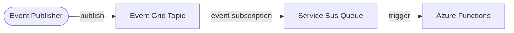

# Azure Event-Driven Integration (Terraform)

> Decoupled eventing on Azure: Event Grid routes events to a Service Bus queue consumed by Azure Functions — provisioned with Terraform.
> **Author:** Muhammad Ahmad · **IaC:** Terraform · **Cloud:** Azure


---

## 📌 Overview

- **Event Grid topic** is the ingress point for events from publishers.
- An **event subscription** routes those events to a **Service Bus queue** (durable buffering, ordering, retries).
- An **Azure Functions** app consumes the queue and processes events.

Event Grid handles fan-out/routing; Service Bus guarantees delivery — a robust enterprise integration pattern.

## 🏗️ Architecture

> 🎨 **Interactive diagram (industry-standard icons):** [open in Lucid — page 18](https://lucid.app/lucidchart/3da75ce3-ea66-4296-81b3-00d20a60435b/edit)



## 🚀 Deploy

```bash
cd terraform
az login
terraform init
terraform apply
```

## 🧹 Clean up

```bash
terraform destroy
```

## 💰 Cost note

Event Grid and Functions are pay-per-use; Service Bus **Standard** has a small base fee. Low idle cost.

## 🔐 Production hardening (next steps)

- Add **dead-lettering** and duplicate detection on the queue.
- Use **managed identity** between Functions and Service Bus.
- Add **event schema validation** and filtering on the subscription.

---

*Built and maintained by **Muhammad Ahmad**.*
