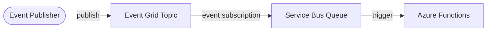

# Architecture Diagram — Azure Event-Driven Integration

## Lucid diagram

- **View:** https://lucid.app/lucidchart/be67ec3e-e551-4182-98fb-e7c2c6944498/view
- **Edit:** https://lucid.app/lucidchart/be67ec3e-e551-4182-98fb-e7c2c6944498/edit

## Lucid prompt (reusable)

```
Create an Azure architecture diagram titled "Azure Event-Driven Integration".
An Event Publisher publishes to an Event Grid Topic; an event subscription routes
events to a Service Bus Queue; an Azure Functions app is triggered by the queue to
process events. Label the arrows. Clean, professional Azure colors.
```

## Mermaid source


